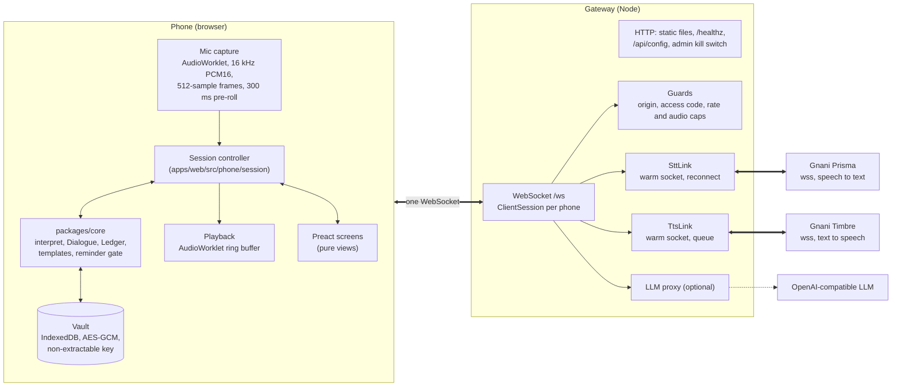
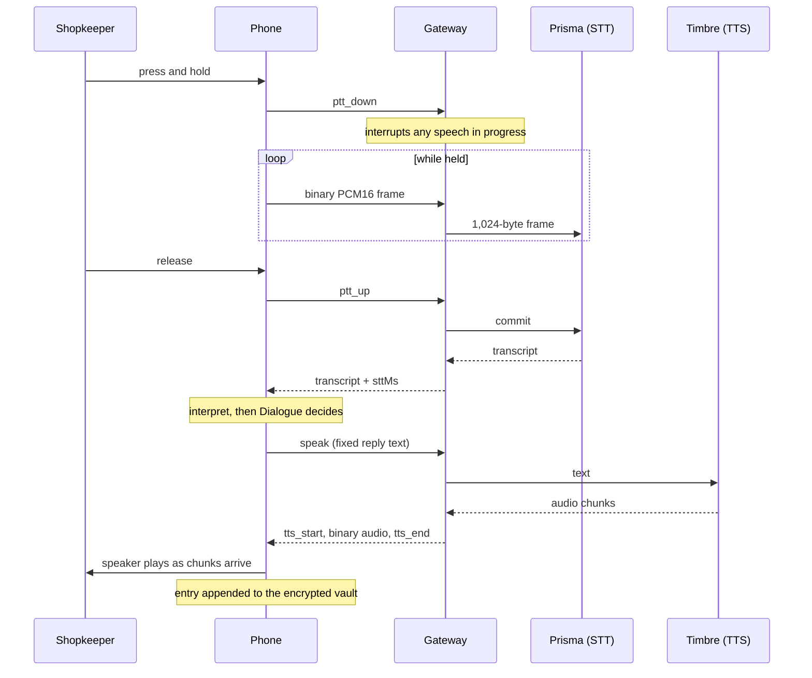
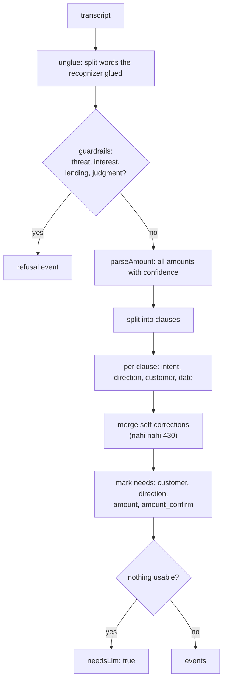

# About Vidur: the technical picture

This document explains how Vidur is built: what runs where, how one spoken sentence becomes a ledger entry, the protocol between the phone and the gateway, the data model, the safety rules, and the tools behind it. The [README](../README.md) covers what the product does and how to run it.

## Contents

1. [The idea in one paragraph](#the-idea-in-one-paragraph)
2. [Tech stack](#tech-stack)
3. [System architecture](#system-architecture)
4. [Anatomy of one turn](#anatomy-of-one-turn)
5. [The core package](#the-core-package)
6. [The dialogue engine](#the-dialogue-engine)
7. [The gateway](#the-gateway)
8. [The phone app](#the-phone-app)
9. [The showcase page](#the-showcase-page)
10. [Data model and storage](#data-model-and-storage)
11. [Safety and privacy design](#safety-and-privacy-design)
12. [Evaluation](#evaluation)
13. [Build, test and deploy](#build-test-and-deploy)
14. [Design decisions and trade-offs](#design-decisions-and-trade-offs)
15. [Known limits](#known-limits)

---

## The idea in one paragraph

Vidur is a voice-first credit ledger (a *khata*) for small shops. The shopkeeper holds a button and speaks. Speech goes to Gnani's Prisma for transcription. A deterministic parser running **on the phone** turns the transcript into a structured entry. A small dialogue engine decides whether to save, ask a question, or refuse, and replies with fixed wording. The reply is synthesized by Gnani's Timbre and played back. A thin Node gateway sits between phone and Gnani to keep the API key off the device. The ledger never leaves the phone: it is event-sourced and stored encrypted in the browser.

The central design choice is that **the language model, if there is one, never decides money**. Amounts come from our own number parser, and anything uncertain is read back before it is saved.

## Tech stack

| Layer | Choice | Why |
|---|---|---|
| Language | TypeScript 5.9, strict, `noUncheckedIndexedAccess`, ESM with NodeNext | one language across phone, gateway and logic; strictness catches money bugs early |
| Runtime | Node 22 or newer | native `fetch`, `process.loadEnvFile`, stable WebSocket tooling |
| Monorepo | npm workspaces: `packages/core`, `apps/server`, `apps/web` | the pure logic is shared by the browser, the server and the tests without publishing anything |
| Phone UI | Preact 11 + Vite 8 | about 58.5 KB of JavaScript gzipped, which matters on low-end Android |
| Gateway | plain Node `http` + `ws` 8 | the gateway is a relay with guards, so no framework is needed |
| Speech to text | Gnani **Prisma v3** over WebSocket | streaming, `commit` message ends an utterance without waiting for silence |
| Text to speech | Gnani **Timbre v3**, voice Avinash, over WebSocket | streams audio chunks while it synthesizes |
| Optional LLM | any OpenAI-compatible endpoint (Groq, `openai/gpt-oss-20b` by default) | reads sentences the parser cannot; strictly untrusted output |
| On-device storage | IndexedDB + WebCrypto AES-GCM 256 | encrypted at rest, key is non-extractable |
| Audio | AudioWorklet capture (resample to 16 kHz PCM16) and AudioWorklet playback ring buffer | low-latency, and playback can be cut within one render quantum |
| Tests | Vitest 5 (about 1,500 tests), Playwright (real Chromium, fake microphone), `fake-indexeddb` | unit, integration, red-team and end-to-end layers |
| Quality | ESLint 10 with typescript-eslint, Prettier, a secret scanner, a pre-commit hook, GitHub Actions CI | |
| Packaging | multi-stage Dockerfile, `docker-compose.yml`, Render blueprint (`render.yaml`) | one container serves the phone app, the showcase and the gateway |

## System architecture



Three boundaries matter:

- **Phone to gateway** is one WebSocket carrying binary audio frames up, binary audio chunks down, and small JSON control messages both ways.
- **Gateway to Gnani** is two long-lived WebSockets per phone (one for speech to text, one for text to speech), opened as soon as the phone says hello, so the first turn has nothing to wait for.
- **Logic stays on the phone.** The gateway never sees a ledger, a balance or a decision. It sees audio, a transcript string, and a sentence to speak.

## Anatomy of one turn



1. **Press.** `ptt_down` also acts as a barge-in: anything the agent is saying stops at once. The phone stops playback locally within one audio render quantum (about 3 ms) and tells the gateway to drop queued speech.
2. **Stream.** The microphone is captured by an AudioWorklet that resamples to 16 kHz PCM16 and cuts exact 512-sample frames. A 300 ms pre-roll ring means the first syllable is not lost if the user starts speaking just as they press. The gateway re-chunks the audio into 1,024-byte frames (32 ms) for Prisma.
3. **Release.** `ptt_up` makes the gateway send Prisma `{"type":"commit"}`. There is no wait for silence, so release to transcript is about 140 ms.
4. **Interpret.** The transcript reaches `interpret()` in `packages/core`, which returns structured events (intent, customer, amount in paise, date token, and a list of `needs` such as `direction` or `amount_confirm`).
5. **Decide.** The `Dialogue` engine resolves the customer against the ledger and either commits, asks a question, or refuses.
6. **Speak.** The reply is a fixed template in the user's language. The phone sends it as `speak`; the gateway streams it to Timbre and forwards audio chunks as they arrive. The very first line of a session is always the AI disclosure.
7. **Persist.** A committed entry is appended to the ledger and sealed into IndexedDB.

If `interpret()` finds nothing it can use, the phone may send `parse` to get the optional LLM's proposal. That proposal passes through `groundLlmOutput` before anything acts on it (see [Safety](#safety-and-privacy-design)).

## The core package

`packages/core` holds everything that decides something. It runs unchanged in the browser, in Node and in tests. **It is pure:** `purity.test.ts` fails the build if any non-test source in it imports a Node module, touches the network, the DOM, storage, or reads `process.env`.

| Module | Responsibility |
|---|---|
| `numbers/` | Spoken amount parser. Per-language JSON tables (`hi`, `en`, `kn` in full, plus tables for `bn`, `gu`, `ml`, `mr`, `pa`, `ta`, `te` not yet wired end to end). Handles compound forms (`teen sau chalis`), fractions (`dedh sau` 150, `sawa do sau` 225, `paune teen sau` 275, `dhai hazaar` 2,500), lakh and crore, native digits, and glued words from the recognizer (`unglue.ts`: `saudhar` becomes `sau udhar`). Every match carries a **confidence**; below `CONFIRM_BELOW` (0.75) the amount must be read back. |
| `intent/` | `interpret()`: runs guardrails first, then amounts, clause splitting, per-clause intent, customer guess, date token, and a final pass that decides which amounts must be read back. `guardrails.ts` detects threats, interest, lending and credit judgments. `ground.ts` validates LLM output. |
| `names/` | Customer matching across scripts: transliteration of Devanagari and Kannada to Latin (`translit.ts`), spelling-tolerant keys (`nameKey`, `looseKey`), exact, ambiguous and near matches, aliases ("doodh wale"). |
| `dates/` | Date tokens (`today`, `yesterday`, `weekday:monday`, ...) resolved in IST. |
| `dialogue/` | The `Dialogue` state machine (next section). |
| `ledger/` | Event-sourced ledger over a `LedgerStore` interface (`MemoryStore` for tests, the vault in the browser). |
| `i18n/` | Fixed reply templates in `hi`, `en`, `kn`, as a typed key-to-function table. |
| `speak/` | `amountToSpoken`: formats rupees with Indian digit grouping (`₹1,20,000`), the form Timbre reads correctly in all three languages. |
| `reminders/` | `canRemind`: the single gate for reminders (opt-in recorded, a balance due, at least 7 days since the last one). |
| `demo/` | The 12-customer synthetic seed ledger. |

### How `interpret()` reads a sentence



The refusal check runs **before** anything else, so a refusal can never be talked into a ledger write. The read-back marking is deliberately conservative: any amount of ₹10,000 or more, any four-digit amount on an entry that is already asking for a name or direction, and every amount in an utterance with unresolved fragments is flagged `amount_confirm`.

## The dialogue engine

`Dialogue.handle(text)` returns a list of `Reply` objects (`key`, `text`, `lang`, optional share-reminder action). Everything leaves through one `emit` function that **puts the AI disclosure first until it has been said**, so no code path can speak before disclosing.

The engine is a small state machine around one nullable `pending` question:

| Pending kind | Asked when |
|---|---|
| `direction` | an entry has an amount but not whether it is credit or payment |
| `amount` | an entry has no amount |
| `confirm_amount` | the amount is large, low-confidence or flagged by the interpreter |
| `which` | the name matches more than one customer ("which Ramesh?") |
| `near` | the name is close to, but not exactly, an existing one |
| `customer` | no usable name |
| `consent` | a reminder was asked for and consent is not recorded |
| `new_customer` | the name is unknown: a customer is never created without a yes |

Rules the engine enforces:

- A pending question **expires after 30 seconds** (`pendingTtlMs`). Nothing awaiting an answer is ever saved.
- If the next utterance is not an answer, the question is **dropped, never guessed**, and the engine says so.
- A correction ("nahi, 500", "galat") applies only to an entry newer than the **15-minute undo window**.
- A multi-event sentence ("Ramesh ka 340 udhaar, kal 200 diya tha") is processed event by event; if one stops to ask, the rest wait inside the pending work.
- Notes ("Mohan kal paanch sau dega") are stored as `note_added` events and never affect a balance.

## The gateway

`apps/server` is a relay with guards. It holds the Gnani key, so the browser never sees it, and it stores nothing.

**HTTP routes:** static files from `apps/web/dist`, `GET /healthz`, `GET /api/config` (mode, whether an access code is needed, whether an LLM is configured), and `POST /admin/kill` and `/admin/revive` (exist only when `ADMIN_KEY` is set; they switch speech off and on).

**WebSocket `/ws`** (max payload 64 KB). One `ClientSession` per phone.

| Phone to gateway | Meaning |
|---|---|
| `hello` `{lang, accessCode?, token?}` | start a session; opens both Gnani sockets |
| `ptt_down` / `ptt_up` | start and end of a press (also barge-in) |
| binary frame | 16 kHz PCM16 audio, accepted only while a press is active |
| `context` `{names, keyterms}` | customer names and terms sent to the recognizer as keyterms |
| `speak` `{id, text}` | synthesize one fixed reply |
| `interrupt` | stop speaking, drop queued speech |
| `parse` `{id, text}` | ask the optional LLM (capped at 20 calls per session) |

| Gateway to phone | Meaning |
|---|---|
| `ready` `{token, mode, llm, degraded}` | session is ready; `token` is reused on reconnect |
| `speech_start`, `transcript` `{text, lang, sttMs, audioMs}` | recognition result |
| `tts_start`, binary audio, `tts_end` | speech playback for one `speak` |
| `metric` `{name, ms}` | timings (`release_to_transcript_ms`, `tts_first_audio_ms`) |
| `parsed` `{id, raw}` | the LLM's raw proposal, or null |
| `error` `{code, recoverable}` | failure with a machine-readable code |

**Speech links** (`gnani.ts`). `SttLink` and `TtsLink` each keep one warm socket per phone. STT runs with `format=codemix` and one locale per connection (`hi-IN`, `en-IN` or `kn-IN`), and the language can change mid-session with `update_settings`. STT sessions are recycled before Gnani's 15-minute cap. TTS requests run one after another on a reused socket; the gateway treats the `complete` message that carries `message: "Streaming completed"` as the end. Connection failures back off exponentially on recoverable errors (rate limit, network) and stop on auth or out-of-credit errors, which reach the phone as specific codes so it can say so in the user's language.

**Guards** (`guards.ts`, deterministic given a clock, each with a test):

| Guard | Applies | Behaviour |
|---|---|---|
| Origin check | all modes | cross-origin upgrades get 403; loopback origins allowed outside hosted mode |
| Access code | hosted | compared in constant time; a signed HMAC token (2 hours) lets a phone reconnect without retyping |
| Per-IP rate | hosted | sliding one-minute window, 429 |
| Concurrent sessions | hosted | cap (10 by default), 503 `busy` |
| Audio caps | hosted | speech heard plus spoken counted per session (8 minutes) and per day (90 minutes) |
| Kill switch | all | refuses new sessions and closes running ones |

**Logging** (`logger.ts`) refuses fields whose names suggest content, and values that are not short plain identifiers. It throws in development and tests and redacts in production, so a transcript or a customer name cannot reach a log by accident.

**Mock Gnani** (`mock-gnani/`) is a local fake of both speech services with scripted transcripts, used by `MODE=mock`, the end-to-end tests and most server tests.

## The phone app

`apps/web/src/phone/`:

- **`contract.ts`** defines the view-model contract: screens receive plain view models and call action callbacks.
- **`ui/`** holds the screens (`Home`, `Customers`, `CustomerDetail`, `History`, `Reminders`, `Settings`, `Keypad`, `Onboarding`, `VoiceOrb`, and so on). They are **pure**: they never touch audio, storage or the network, which makes them testable by rendering to a string.
- **`session/controller.ts`** (`PhoneSession`) is the one place that wires everything: the vault, the ledger, the dialogue engine, microphone capture, playback and the gateway client. It tracks the phase (`idle`, `listening`, `thinking`, `speaking`, `needs_answer`, `offline`), runs the 10-second undo timer, purges old transcripts hourly, and reports telemetry.
- **`net/gateway.ts`** is the WebSocket client: reconnects with backoff (0.5, 1, 2, 4, 8 seconds), carries the session token across reconnects, and exposes the protocol as plain methods.
- **`audio/`**: `capture.ts` (microphone, resampling AudioWorklet, pre-roll), `playback.ts` (AudioWorklet ring buffer, can flush at once), `pcm.ts`, `levels.ts` (drives the voice orb).
- **`storage/vault.ts`**: the encrypted store (see below).

State is a tiny store (`store.ts`) with subscribe and update. If the speech service is unusable (out of credit, bad key), the app says so in the user's language, stays usable by keypad, and goes offline for voice only.

## The showcase page

`apps/web/index.html` and `src/showcase/` form the page at `/`. It frames the phone app (`app.html`) in an iframe and talks to it with a small `postMessage` bridge:

- **down** (`vidur:set`, `vidur:scene`): showcase tells the phone to change theme, language, frame (notch, no notch, punch hole) or scene.
- **up** (`vidur:ready`, `vidur:prefs`, `vidur:feature`, `vidur:telemetry`): the phone reports readiness, its saved theme and language, which feature was tapped, and per-turn telemetry (transcript, parse, STT time, time to first audio).

Clicking a feature explains it; the telemetry panel fills from a real turn in the iframe. The phone owns its saved settings, and the page no longer overwrites them.

## Data model and storage

The ledger is **event-sourced**: the stored truth is an append-only list of events, and balances are folded from them. Money is **integer paise**, never a float.

| Event | Fields (besides `id`, `recordedAt`) |
|---|---|
| `customer_created` | `customerId`, `name`, `aliases` |
| `customer_alias_added` | `customerId`, `alias` |
| `entry_posted` | `customerId`, `kind` (`credit` or `payment`), `paise`, `at`, optional `item` |
| `entry_reversed` | `targetId` (an entry, or an earlier reversal: undo of undo restores it) |
| `note_added` | `customerId`, `text`, optional `dueAt` |
| `consent_set` | `customerId`, `optIn` |
| `reminder_sent` | `customerId` (records that a reminder text was prepared) |

Every entry carries two times: `at`, when the money moved (can be backdated, "kal"), and `recordedAt`, when it was written down. Both are shown in the UI.

**Vault** (`storage/vault.ts`). IndexedDB with four object stores (`keys`, `events`, `transcripts`, `meta`). Each event, transcript and settings blob is sealed with **AES-GCM 256** and a fresh 12-byte IV. The master key is generated by WebCrypto as **non-extractable** and kept in IndexedDB as a `CryptoKey`, so page code can use it but cannot read its bytes. Transcripts are purged after 24 hours. "Delete all data" in Settings removes events, transcripts, settings and the key. The server has no database and writes no files.

## Safety and privacy design

| Concern | Mechanism |
|---|---|
| A language model inventing or changing an amount | `groundLlmOutput` accepts an LLM amount only if `parseAmount` independently finds the same value in the transcript; otherwise the amount is dropped and the app asks. Customer names must sound like a word actually said, intents must be known, dates must be fixed tokens. |
| Prompt injection | The LLM only proposes; the deterministic parser and dialogue decide. The system prompt tells the model to treat the transcript as data. The injected-instruction rows in the red-team set leave the ledger unchanged. |
| Saving a wrong amount silently | Low-confidence, large (₹10,000 and up) and garbled amounts are read back first; 0 silently wrong amounts in 240 noisy recordings. |
| Saving while unsure | Nothing awaiting an answer is saved; questions expire after 30 seconds. |
| Speaking before disclosing | One `emit` function puts the AI disclosure first. Tested for every kind of first utterance in three languages. |
| Pressure, threats, interest, lending, judgments | `guardrails.ts` runs before everything else; fixed polite templates; a test scans every template for pressure words; 83 red-team utterances. |
| Unwanted reminders | `canRemind` gate (opt-in, balance due, 7-day gap); the app only prepares text for the browser share sheet and sends nothing. |
| Customer data exposure | Ledger encrypted on the phone; server stores nothing; logger refuses content; transcripts purged after 24 hours; delete-all. |
| Key exposure | The key lives only in the server's environment; `.env` is git-ignored; a secret scanner runs in a pre-commit hook, in CI, and over history. |
| Abuse and cost | Guards: origin, access code, rate limit, session and daily audio caps, kill switch. |

## Evaluation

| Piece | What it does |
|---|---|
| `eval/golden/` | 165 golden utterances and a held-out set of 140 (Hindi, Hinglish, English, Kannada) with expected intent, amount and customer, validated by a schema; the parser is scored against both in the normal test run. |
| `eval/redteam/` | 83 utterances: threats, shaming, interest, lending, credit judgments, reminders without consent, prompt injections, data requests, out-of-scope, and benign look-alikes. The full dialogue runs on each, and the ledger and consent records must be byte-identical afterwards. |
| `eval/corpus/` | Generates audio: golden utterances rendered by several Timbre voices, mixed with synthetic noise at clean, 15, 10 and 5 dB. |
| `eval/run/` | Sends the corpus through real Prisma and the deterministic parser (spends Gnani credits; refuses to run without `--yes`). |
| `eval/score/` | Computes intent, direction and amount accuracy, **silent-wrong count**, and latency percentiles per language and noise level. A silently wrong amount makes the scorer exit non-zero. |
| `e2e/` | Playwright against the built app with a fake microphone: barge-in, raw IndexedDB unreadable, delete-all, CPU-throttled turn, bundle size, and a live disclosure check. |

Headline numbers: direction right 99.5% and amount right 94.7% (saved directly or after a read-back) over 240 noisy recordings, with **0 silently wrong amounts**; button release to first audio p50 648 ms and p95 1.8 s in a real browser against real Gnani. The recordings are synthetic speech recognized by Prisma, which flatters accuracy, so a real voice in a real room is the check that matters.

## Build, test and deploy

```bash
npm run build       # core, then server (tsc), then web (vite): order matters
npm run typecheck   # builds core first, then tsc --noEmit on each project
npm test            # vitest: apps/*/src and packages/*/src
npm run test:e2e    # builds, then real Chromium
```

- **Vitest alias:** `@vidur/core` resolves to the TypeScript source, so unit tests do not need core built. Typecheck and the server and web builds consume `packages/core/dist`.
- **CI** (`.github/workflows/ci.yml`) runs the secret scan, typecheck, lint, tests and build on every push and pull request. The pre-commit hook runs the secret scan on staged files plus typecheck.
- **Container:** the Dockerfile builds everything in a first stage and copies only the built server, core and web output into a small runtime stage with production dependencies. No key is ever baked into the image.
- **Hosting:** `render.yaml` is a Render blueprint for one free web service in `hosted` mode, auto-deploy off. Keys and the access code are entered in the host's dashboard.
- **Server modes:** `local` binds to loopback and uses your key; `mock` needs no keys and makes no outside calls; `hosted` requires an access code, binds to all interfaces and applies the tighter caps.

## Design decisions and trade-offs

- **Push to talk with `commit`, not voice-activity detection.** Measured on the same clip: release to transcript about 184 ms with `commit`, against roughly 530 to 765 ms from true end of speech for VAD settings of 300 to 500 ms. It also never cuts a sentence at a natural pause. The cost is a button, which suits a noisy counter anyway.
- **`format=codemix`, not digit output.** In a 20-clip test the recognizer's own number-to-digits conversion got fractions wrong ("sawa do sau" came back as 250). `codemix` returns number words, which our parser reads. The STT's digits are not trusted for money.
- **Deterministic first, model second.** The parser handles every required case without a model, so the app works with no LLM key. The model is a fallback for sentences the parser cannot read, and its output is checked against the transcript.
- **Our own orchestration.** Streaming, parsing and deciding are our code; Prisma and Timbre are called directly. This gives full control of barge-in and endpointing and keeps the logic testable.
- **Logic on the phone, not the server.** The gateway cannot leak a ledger it never sees, and the app keeps working for keypad entry when the connection drops.
- **Amounts spoken as `₹` plus digits inside the reply language.** Mixing Latin text with bare digits made Timbre read amounts in the wrong language, so each reply keeps one script. English replies use the `en-IN` voice setting for the same reason: with automatic detection, a Devanagari customer name made the amount come out in Hindi.
- **Fixed replies.** Wording is predictable, reviewable and free of pressure language. The cost is less natural phrasing.
- **Free hosting.** The hosted copy runs on a free plan that sleeps when idle; the app is small and stateless so a cold start is just a process start.

## Known limits

- Accuracy numbers come from synthetic speech. A live test with real voices and room noise is the real check.
- The encryption key cannot be read out of the browser, but script running in the same page could still ask it to decrypt. Keeping the code small and the dependencies few is the mitigation.
- The shopkeeper records a customer's reminder consent on the customer's behalf; the app cannot verify it.
- Kannada reply wording was written without a native speaker and needs a review.
- Only Hindi, Hinglish, English and Kannada work end to end. The tables for seven more languages exist but the replies, templates and tests do not.
- Not built: a hands-free wake phrase (Counter Mode), two recognizers cross-checking each other (Two Ears), and an Android package.
- With an LLM key set, the transcript sentence (and nothing else) is sent to the LLM provider.
